# 2026-10-12 架构与完成度评审

| 项目 | 内容 |
|------|------|
| 类型 | 历史需求变更（评审结论 → 改造需求） |
| 日期 | 2026-10-12 |
| 评审对象 | 改造前的 `src/`、`api_server.py`、`main.py`、`test_moving_llm.py` |
| 方法 | 源码静态审阅。得分是阅读代码后的判断，不是跑分 |
| 原始画布 | [2026-10-12-architecture-review.canvas.tsx](2026-10-12-architecture-review.canvas.tsx) |
| 落地结果 | 本评审的改进项已写入 [design.md](../design.md) 和 [architecture.md](../architecture.md)，并已在代码中实现 |

本文记录的是**改造前**的状态。文中的文件名，例如 `image_analyzer.py`、`test_moving_llm.py`，在改造后已经被删除或替换。

## 总览

| 指标 | 值 |
|------|----|
| 综合完成度 | 45% |
| 文档自称完成度 | 100% |
| 演示骨架（CLI + 流水线） | 可用 |
| 尺寸与装载结论 | 不可用 |

**结论**：分层方向是对的：照片先变成结构化家具，体积和纸箱用确定性代码算，语言模型只负责叙述建议。当前实现停在可跑通的原型。测量没有尺度，规划公式有明显错误，文档里的“精确估算”和“装载优化”还没有对应算法。

## 各模块完成度

骨架分表示代码路径是否存在；正确性分表示结果能否当作搬家决策。

```mermaid
xychart-beta
    title "各模块完成度（评审得分，满分 100）"
    x-axis ["图像识别", "空间估算", "纸箱计算", "Agent 编排", "命令行", "HTTP API", "配置", "测试"]
    y-axis "评审得分" 0 --> 100
    bar [70, 75, 65, 70, 85, 60, 40, 45]
    bar [30, 25, 30, 45, 70, 20, 15, 20]
```

图中第一组柱为骨架完成度，第二组柱为结果正确性。原始数据：

| 模块 | 骨架完成度 | 结果正确性 |
|------|-----------:|-----------:|
| 图像识别 | 70 | 30 |
| 空间估算 | 75 | 25 |
| 纸箱计算 | 65 | 30 |
| Agent 编排 | 70 | 45 |
| 命令行 | 85 | 70 |
| HTTP API | 60 | 20 |
| 配置 | 40 | 15 |
| 测试 | 45 | 20 |

来源：对 11 个 Python 文件的静态审阅 · 2026-10-12 · 单位：评审得分（满分 100）

## 能力对照

| 承诺的能力 | 代码里实际有的 | 判断 |
|------------|----------------|------|
| 照片识别家具类型、尺寸、重量 | GPT 视觉提示 + 花括号截取 JSON。无 schema、无重试、无置信度过滤 | 能出结果，尺寸不可信 |
| 空间估算与装载效率 | 体积乘系数。效率恒为 100/1.3，约 76.92% | 效率是常数，不是测量 |
| 纸箱数量与承重 | 按体积整除箱子容积。重量上限只展示，不参与计算 | 几何和承重都没约束 |
| 装载顺序 | `calculate_loading_order` 排好序后丢弃，`MovingPlan` 无此字段 | 算了但没交付 |
| 命令行报告 | `main.py` 校验路径、打印清单、费用、建议 | 主路径可用 |
| `POST /analyze` | 建了临时路径，未写入上传内容，也未加入待分析列表 | 会返回空计划 |
| 费用与工时 | 每立方米 150 元、每件 15 分钟等常数，无距离、楼层、电梯 | 示意报价，不是估价 |

## 架构判断

主链路是 `ImageAnalyzer` 产出 `FurnitureItem`，`SpaceEstimator` 与 `BoxCalculator` 各自计算，`MovingLLMAgent` 组装 `MovingPlan`，需要时再调一次聊天接口写建议。命令行和 FastAPI 共用这一个 Agent。这个切分适合继续扩展：感知、规划、叙述三层职责清楚，算术不交给模型。

| 层 | 评审发现 |
|----|----------|
| 感知层 | 模型名、图片压缩、提示词和解析绑在 `ImageAnalyzer` 里。OpenCV 的 `enhance_with_cv` 没有被调用。`requirements.txt` 里的 torch、transformers 没有任何引用 |
| 规划层 | 估算器是纯函数式模块，这点好。输入只有家具包围盒，没有房间、楼层、通道和目的地。所谓优化是几条固定中文提示 |
| 交付层 | CLI 与 API 重复拼装响应，没有共享的响应模型。`config.yaml` 从未被读取，运行参数只来自环境变量，其中置信度和最大检测数也没有使用方 |

## 会直接算错的地方

### 体积被加了两次

`space_estimator.py` 把“可拆或长度小于 150cm”的物品计入 `packed_volume`，又把“不可拆”的物品全部计入 `unpacked_volume`。一把不可拆、长度 60cm 的椅子会两边都进。椅子体积 360,000 cm³ 时，有效体积大约变成 727,200 cm³，接近两倍。可拆家具因为第二段排除了 `disassemble`，不会双计。

### 装载效率与文档示例一致，因为公式是恒等式

`packing_efficiency = effective_volume / (effective_volume × 1.3) × 100`。只要体积不为 0，结果就是 76.92%。README 和 PROJECT_SUMMARY 里的 76.92% 就是这个常数，不能用来比较方案。

### 纸箱忽略件数和形状

大件、中件分支用单件体积，不乘 `quantity`。小件分支乘了。不可拆且体积大于 300,000 cm³ 的家具直接跳过；不可拆的大件函数还会显式返回 0 个超大箱。重量字段不参与箱数。`calculate_additional_boxes` 没有调用点。

### POST /analyze 分析的是空列表

上传循环里 `tempfile.mktemp` 之后没有把文件写入磁盘，也没有 append 到 `temp_files`。随后 `analyze_moving_plan([])` 仍会算出一辆小型厢式车和至少 200 元人工费。`/recommend` 写入了文件，但响应用 `dataclass.__dict__`，里面的 `Dimensions` 和枚举无法被 JSON 序列化。

## 技术方案是否站得住

用视觉模型做家具类型和易碎、可拆判断，是合理的第一版。用它直接输出厘米和千克，则缺少尺度：照片里没有参照物、没有相机内参、没有用户确认。后面的车辆、纸箱、报价都乘在这个误差上。OpenCV 边缘和依赖里的本地模型没有接到这条链上，所以 Jetson 的 GPU 目前也用不上。

纸箱如果要当真，至少要同时满足外包络能放进箱子、以及重量不超过承重。现在只做体积整除，一把细长桌腿和一团同体积软物会得到相同箱数。车辆推荐同理：只有立方米阈值，没有最长边是否进得了车厢门。

测试有 5 个，覆盖模型和“体积大于 0”“箱数大于等于 0”。断言放得过宽，上面的双计、恒定效率和丢弃的装载顺序都不会失败。图像解析、Agent 和 API 没有测试。

## 后续改进（转为改造需求）

| 顺序 | 改什么 | 为什么先做 |
|------|--------|------------|
| 1 | 修好 `/analyze` 落盘；响应改成可序列化模型；删掉或接上 `config.yaml` | 接口现在会安静地给出空计划 |
| 2 | 体积只计一次；效率改为有效体积 / 所选车厢容积；装载顺序写入 `MovingPlan` | 否则报告里的核心数字没有意义 |
| 3 | 视觉输出改为 JSON schema。尺寸默认标成待确认，允许用户改长宽高后再重算 | 误差最大的环节在测量，不在文案 |
| 4 | 箱数同时受外包络和承重约束，大件默认不装箱、只占车厢。件数参与所有分支 | 和真实打包方式一致 |
| 5 | 搬家任务补上距离、楼层、电梯、最长边。费用系数从代码常数挪到配置 | 当前报价无法随场景变化 |
| 6 | 模型调用收成可替换接口。本地视觉要做再引入 torch；否则从 requirements 去掉 | 依赖和架构应对齐实际路径 |

不建议先加更多提示词或再包一层 Agent。把测量确认和体积公式做对之后，现有的三层结构可以直接承载后续的车厢门尺寸和楼层工时。

## 落地情况

| 顺序 | 落地位置 | 验证 |
|------|----------|------|
| 1 | `api_server.py` 先写临时目录再分析，响应模型为 `MovingPlan`；`src/config.py` 读取 `config/config.yaml` | `tests/test_api.py` |
| 2 | `src/space_estimator.py` 区分散装体积与纸箱外体积，效率按所选车厢计算；`loading_order` 写入结果 | `tests/test_planning.py` |
| 3 | `src/provider.py` 校验 JSON、过滤低置信度、解析失败重试一次；`POST /recalculate` 和 `plan_from_items` 用确认后的尺寸重算 | `tests/test_vision_parse.py`、`tests/test_api.py` |
| 4 | `src/cargo.py` 判断散装；`src/box_calculator.py` 按外包络、填充率、承重和件数装箱 | `tests/test_planning.py` |
| 5 | `MoveContext` 携带距离、楼层、电梯；车型含门宽、门高、最长边；单价在 `config/config.yaml` | `tests/test_planning.py` |
| 6 | `MovingLLMProvider` 协议与 `OpenAIProvider`；requirements 去掉 torch、transformers、opencv | `tests/test_planning.py` |
